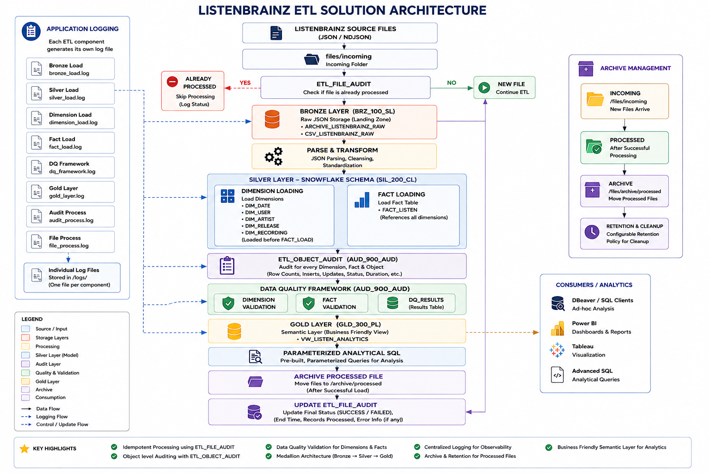
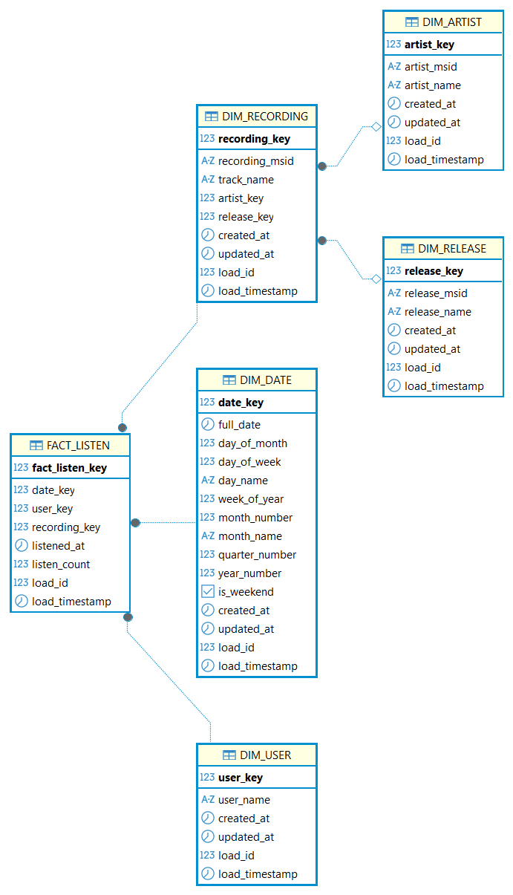

# ListenBrainz ETL Assignment

## Table of Contents

1. Project Overview
2. Assignment Objectives
3. Solution Architecture
4. Technology Stack
5. Project Structure
6. ETL Pipeline
7. Data Model
8. Data Quality Framework
9. Audit Framework
10. Gold Semantic Layer
11. Analytical Queries
12. Source Data Analysis
13. Business Assumptions
14. Design Decisions
15. Future Enhancements
16. How to Run
17. Conclusion

## Project Overview

This project implements an end-to-end ETL solution for the ListenBrainz dataset using a Medallion data warehouse architecture. The solution ingests raw JSON listening events, transforms them into a dimensional **Snowflake Schema**, performs automated data quality validation, records ETL audit information, and exposes a semantic Gold layer for analytical reporting.

The implementation consists of:

- Bronze Layer for raw data ingestion
- Silver Layer implementing a dimensional Snowflake Schema
- Gold Layer providing a business-friendly semantic view
- Data Quality and Audit Framework
- Incremental and idempotent file processing using ETL_FILE_AUDIT.
- Parameterized analytical SQL queries to answer the business questions

The solution has been designed with production-oriented principles including modularity, maintainability, auditability, and clear separation of responsibilities between each processing layer.

## Key Features

• Medallion Architecture
• Snowflake Schema
• Incremental ETL
• Idempotent File Processing
• Data Quality Framework
• ETL Audit Framework
• Gold Semantic Layer
• Parameterized SQL
• Production-Oriented Design

## Assignment Objectives

This assignment focuses on designing a scalable data engineering solution that demonstrates modern ETL and data warehousing practices. The objective is not only to load data into a database, but also to design a maintainable architecture that supports data quality, auditing, historical tracking, and business analytics.

The solution aims to:

- Design a layered data warehouse architecture.
- Build a dimensional model using fact and dimension tables.
- Implement data transformation and loading processes.
- Ensure data quality through automated validation rules.
- Capture ETL execution details using an audit framework.
- Expose a semantic layer for business reporting.
- Answer the analytical business questions using SQL.

## Solution Architecture



**Figure 1:** Overall Architectural Diagram for ListenBrainz warehouse

## Technology Stack

The solution has been developed using open-source technologies to provide a lightweight, portable, and production-oriented ETL framework.

| Category | Technology | Purpose |
|----------|------------|---------|
| Programming Language | Python 3.x | ETL development |
| Database | DuckDB | Data warehouse and analytical processing |
| Data Format | JSON / NDJSON | Source data ingestion |
| SQL Engine | DuckDB SQL | Data transformation and analytics |
| IDE | Visual Studio Code | Development |
| Database Client | DBeaver | Database administration and query execution |
| Version Control | Git | Source code management |
| Architecture | Medallion Architecture | Layered ETL design |
| Data Model | Snowflake Schema | Dimensional modeling |
| Reporting Layer | Gold Semantic View | Business-friendly analytics |

## Project Structure

The project follows a modular folder structure that separates configuration, ETL logic, documentation, analytics, and operational artifacts.

```text
ListenBrainz_Assignment
│
├── analytics
│   └── analytical_queries.sql          # Business analytical SQL queries
│
├── config
│   └── Extraction.properties           # Application configuration
│
├── db
│   └── ListenBrainz.duckdb             # DuckDB database
│
├── docs
│   ├── solution_architecture.png
│   └── database_model.png
│
├── files
│   ├── incoming                        # Source files awaiting processing
│   ├── archive                         # Successfully processed files
│   └── error                           # Failed source files
│
├── logs                                # ETL execution logs
│
├── src
│   ├── bronze                          # Bronze layer processing
│   ├── silver                          # Dimension & Fact loading
│   ├── gold                            # Semantic layer
│   ├── dq                              # Data Quality framework
│   └── common                          # Shared utilities & configuration
│
├── README.md
├── requirements.txt
└── run_ListenBrainz_main.py            # ETL entry point
```
### Folder Description

| Folder | Description |
|---------|-------------|
| analytics | Contains parameterized SQL queries used to answer the analytical business questions. |
| config | Stores configurable application properties. |
| db | Contains the DuckDB database. |
| docs | Architecture and database design documentation. |
| files | Incoming, archived, and error source files. |
| logs | Individual log files generated by each ETL component. |
| src | Core ETL implementation organized by Medallion layers and supporting frameworks. |

## ETL Pipeline

The ETL process follows a modular and production-oriented workflow designed to ensure reliable, repeatable, and auditable data processing. Each processing stage has a clearly defined responsibility, with comprehensive logging, auditing, and data quality validation performed throughout the pipeline.

### Step 1 – File Discovery

The ETL scans the `files/incoming` directory for new ListenBrainz source files.

Before processing begins, the `ETL_FILE_AUDIT` table is checked to determine whether the source file has already been successfully processed.

- If the file has already been processed, it is skipped.
- Otherwise, a new audit record is created and processing continues.

This approach ensures idempotent execution and prevents duplicate data loading.

---

### Step 2 – Bronze Layer

The Bronze layer acts as the landing zone for the raw source data.

Each source file is loaded into the `BRZ_100_SL.CSV_LISTENBRAINZ_RAW` table exactly as received, without applying any business transformations.

The Bronze layer stores:

- Record number
- Raw JSON payload
- Source file name
- Load ID
- Load timestamp

Keeping the raw data unchanged preserves data lineage and enables future reprocessing if transformation logic changes.

---

### Step 3 – Silver Layer

The Silver layer transforms the raw JSON data into a normalized Snowflake Schema.

During this stage, the ETL performs:

- JSON parsing
- Data cleansing
- Timestamp standardization
- Business key extraction
- Surrogate key generation
- Dimension loading
- Fact table loading

The Silver layer consists of the following tables:

- DIM_DATE
- DIM_USER
- DIM_ARTIST
- DIM_RELEASE
- DIM_RECORDING
- FACT_LISTEN

Dimensions are loaded before the fact table to ensure all foreign key relationships are resolved.

---

### Step 4 – Object-Level Auditing

Each ETL object (dimension, fact table and Gold view) writes execution statistics to the `ETL_OBJECT_AUDIT` table.

The audit captures information including:

- Object name
- Load ID
- Inserted rows
- Updated rows
- Execution status
- Start time
- End time
- Execution duration

This provides complete traceability for every ETL component.

---

### Step 5 – Data Quality Framework

Once all dimensions and the fact table have been loaded, automated Data Quality (DQ) validations are executed.

The framework validates both dimensions and facts using predefined business rules such as:

- Duplicate business keys
- NULL value validation
- Blank value validation
- Invalid foreign key detection
- Duplicate fact grain validation

All validation results are recorded in the `AUD_900_AUD.DQ_RESULTS` table.

---

### Step 6 – Gold Semantic Layer

The Gold layer exposes a business-friendly semantic view named `VW_LISTEN_ANALYTICS`.

The view joins the fact table with all related dimensions and presents descriptive business attributes instead of surrogate keys.

This semantic layer serves as the primary source for analytical reporting and SQL queries while hiding the complexity of the underlying Snowflake Schema.

---

### Step 7 – Archive & Completion

After the ETL completes successfully:

- The processed source file is moved from `files/incoming` to the archive directory.
- The corresponding `ETL_FILE_AUDIT` record is updated with the final processing status, completion timestamp, and execution details.
- Individual log files generated by each ETL component are available for operational monitoring and troubleshooting.

This final step ensures that the pipeline is restartable, fully traceable, and prevents previously processed files from being reloaded in subsequent executions.

## Data Model

The Silver layer implements a **Snowflake Schema** designed to minimize data redundancy while maintaining referential integrity through normalized dimension tables.

The schema consists of one central fact table and five conformed dimensions.

### Dimension Tables

| Dimension | Description |
|------------|-------------|
| DIM_DATE | Calendar dimension containing date attributes used for time-based analysis. |
| DIM_USER | Stores unique ListenBrainz users. |
| DIM_ARTIST | Stores artist master data. |
| DIM_RELEASE | Stores release (album) information. |
| DIM_RECORDING | Stores recording metadata and maintains relationships to Artist and Release dimensions. |

### Fact Table

| Fact Table | Description |
|------------|-------------|
| FACT_LISTEN | Stores every listening event with references to all dimensions and the corresponding listening timestamp. |

The normalized Snowflake Schema reduces duplication of artist and release information while preserving data consistency. The Gold semantic layer abstracts this complexity by exposing a denormalized business view for reporting.

### Database Model



**Figure 2:** Snowflake Schema implemented for the ListenBrainz analytical data warehouse.

The Gold semantic layer abstracts this normalized model and serves as the primary reporting interface for all analytical queries.

## Data Quality Framework

To ensure the integrity and reliability of the analytical data warehouse, an automated Data Quality (DQ) framework is executed after all dimensions and the fact table have been successfully loaded.

The framework validates both dimension and fact tables against predefined business rules. Validation results are recorded in the `AUD_900_AUD.DQ_RESULTS` table, providing complete visibility into data quality issues for every ETL execution.

### Validation Categories

The framework performs the following validation checks:

| Category | Validation |
|----------|------------|
| Dimension Validation | Duplicate business keys |
| Dimension Validation | NULL business keys |
| Dimension Validation | Blank business keys |
| Dimension Validation | NULL descriptive attributes |
| Dimension Validation | Blank descriptive attributes |
| Fact Validation | Duplicate fact grain detection |
| Fact Validation | Invalid Date Key |
| Fact Validation | Invalid User Key |
| Fact Validation | Invalid Recording Key |
| Dimension Validation | Invalid Artist Key |
| Dimension Validation | Invalid Release Key |

### Validation Process

Each validation rule records the following information:

- Load ID
- Object Name
- Validation Rule
- Number of Failed Rows
- Validation Status (PASS / FAIL)
- Execution Start Time
- Execution End Time

This information enables complete traceability of every validation executed during the ETL process.

### Framework Benefits

The Data Quality framework provides several operational benefits:

- Detects data quality issues immediately after loading.
- Prevents invalid dimensional relationships from going unnoticed.
- Provides complete auditability of validation results.
- Supports troubleshooting through detailed rule-level statistics.
- Can be easily extended with additional business validation rules without modifying the ETL pipeline.

### Implemented Validation Rules

The current implementation includes validation rules across all dimensions and the fact table, including duplicate detection, mandatory field validation, referential integrity checks, and fact grain validation.

The framework has been designed to be metadata-driven, allowing additional validation rules to be incorporated with minimal changes to the existing ETL process.

## Audit Framework

The ETL solution implements a comprehensive audit framework to provide complete visibility into file processing, object-level execution, and operational monitoring.

The audit framework consists of two independent components:

- **ETL_FILE_AUDIT** – Tracks file-level processing.
- **ETL_OBJECT_AUDIT** – Tracks execution statistics for every ETL object.

Together, ETL_FILE_AUDIT and ETL_OBJECT_AUDIT provide complete operational observability across file processing and object-level execution.

### ETL_FILE_AUDIT

The `ETL_FILE_AUDIT` table records the processing status of every source file.

Before processing begins, the ETL verifies whether the source file has already been successfully processed. Files that already exist in the audit table with a successful status are skipped, preventing duplicate processing and ensuring idempotent execution.

The table captures information including:

- Load ID
- Source File Name
- File Size
- Processing Status
- Start Time
- End Time
- Processing Duration
- Number of Records Processed
- Error Message (if applicable)

This enables:

- Idempotent ETL execution
- Duplicate file prevention
- Restart capability after failures
- Complete file processing traceability

---

### ETL_OBJECT_AUDIT

The `ETL_OBJECT_AUDIT` table captures execution statistics for every ETL object processed during a load.

An audit record is generated for each object, including:

- Bronze Layer
- Dimension Tables
- Fact Table
- Gold Layer Views
- Data Quality Framework

The audit records include:

- Load ID
- Object Name
- Object Type
- Insert Count
- Update Count
- Execution Status
- Start Time
- End Time
- Execution Duration

This provides detailed operational insight into each ETL component and simplifies performance monitoring and troubleshooting.

---

### Application Logging

In addition to database auditing, the solution generates dedicated log files for each ETL component.

Logging is implemented throughout the pipeline, including:

- Bronze Layer
- Silver Layer
- Gold Layer
- Data Quality Framework
- Audit Processing

Each log captures execution progress, informational messages, warnings, and errors, enabling efficient operational monitoring and issue diagnosis.

### Framework Benefits

The audit framework provides several operational advantages:

- Complete end-to-end execution traceability
- Prevention of duplicate file processing
- Object-level performance monitoring
- Simplified operational troubleshooting
- Support for restartable ETL execution
- Improved production monitoring and observability

### Operational Monitoring Components

| Component | Purpose |
|-----------|---------|
| ETL_FILE_AUDIT | Tracks file-level execution and prevents duplicate processing. |
| ETL_OBJECT_AUDIT | Records execution statistics for every ETL object. |
| DQ_RESULTS | Stores the outcome of all data quality validation rules. |
| Application Logs | Captures detailed execution logs for every ETL component. |

## Gold Semantic Layer

The Gold layer provides a business-friendly semantic view that simplifies analytical reporting by abstracting the underlying Snowflake Schema.

Instead of requiring users to understand the relationships between the fact table and multiple dimension tables, the Gold layer exposes a single denormalized view (`VW_LISTEN_ANALYTICS`) containing descriptive business attributes.

The semantic view joins the listening fact table with all related dimensions and presents meaningful business information such as user names, recording names, artist names, release names, calendar attributes, and listening timestamps.

This approach enables business users and analysts to write analytical queries without requiring knowledge of surrogate keys or complex joins.

### Gold View

| View | Description |
|------|-------------|
| VW_LISTEN_ANALYTICS | Business-friendly semantic view joining the fact table with all dimensions for analytical reporting. |

### Business Attributes Exposed

The semantic view exposes descriptive business attributes including:

- User Name
- Recording Name
- Artist Name
- Release Name
- Listen Date
- Listen Timestamp
- Calendar Attributes (Year, Month, Quarter, Week, Day)
- Listen Hour
- Listen Count

### Benefits

The Gold semantic layer provides several advantages:

- Hides the complexity of the underlying Snowflake Schema.
- Eliminates the need for complex joins in analytical queries.
- Provides a consistent business view across all reports.
- Simplifies SQL development for analysts and business users.
- Serves as the single source for all analytical reporting delivered as part of this assignment.


## Analytical Queries

The solution includes a collection of parameterized SQL queries that demonstrate how the Gold semantic layer can be used to answer common business and analytical questions.

All queries are located in the `analytics/analytical_queries.sql` file and are executed against the `VW_LISTEN_ANALYTICS` semantic view. By querying the Gold layer instead of the underlying Snowflake Schema, the analytical SQL remains simple, reusable, and independent of the physical data model.

The queries support configurable reporting periods and analytical parameters, allowing the same SQL scripts to be executed for different business scenarios without requiring code changes.

### Supported Parameters

| Parameter | Description |
|-----------|-------------|
| `${from_date}` | Reporting period start date (YYYY-MM-DD) |
| `${to_date}` | Reporting period end date (YYYY-MM-DD) |
| `${top_n}` | Number of top users to return |
| `${top_days}` | Number of top listening days per user |
| `${interval_days}` | Rolling active-user window in days |

### Implemented Analytical Queries

The solution includes SQL queries to answer the following analytical questions:

- Identify the top users based on the number of songs listened to during a selected reporting period.
- Calculate the number of unique users who listened to at least one song within a selected reporting period.
- Determine the first song listened to by each user.
- Identify the top listening days for every user based on the number of listens.
- Calculate Daily Active Users (DAU) using a configurable rolling activity window.
- Calculate the running user base and the percentage of active users over time.

## Source Data Analysis

Before designing the ETL solution, the supplied ListenBrainz dataset was analysed to understand its structure, characteristics, and potential modelling requirements.

The following observations were made from the sample dataset.

### Source File

- The source data is provided in JSON/NDJSON format.
- Each record represents a single listening event.
- The JSON structure is nested and contains user, recording, artist, release, and timestamp information.

### Data Coverage

The supplied sample dataset contains listening events covering the period:

**2019-01-01** to **2019-04-15**

This period was used to validate the ETL process and analytical queries.

### Source Platform

ListenBrainz supports listening history collected from multiple music services and media players.

However, the supplied sample dataset contains listening events originating only from **Spotify**.

The ETL solution has been designed in a platform-independent, manner and can be extended to support additional source platforms if they follow the same input schema.

### User Information

The supplied dataset contains user identifiers represented in different formats.

Observations include:

- User names containing Unicode characters from multiple languages.
- User names represented as account aliases rather than personal names.
- User identifiers that appear to be hashed or system-generated.

The ETL solution treats the user name provided by the source system as the business identifier without attempting to interpret or normalize user identities.

### Data Characteristics

The source dataset contains repeated occurrences of the same users, artists, releases, and recordings across multiple listening events.

These entities are consolidated into conformed dimensions during the Silver layer transformation, while the listening events are preserved within the fact table.

## Business Assumptions

The following assumptions were made during the implementation because certain business rules were not explicitly defined within the assignment.

### User Identity

The source dataset does not provide sufficient information to determine whether multiple user names belong to the same individual.

Therefore, the implementation assumes:

- Each unique user name represents one user account.
- User accounts are not merged or deduplicated.

### User Inception Date

The source data does not contain a user registration date.

For analytical purposes, the user's first listening date (`MIN(listened_at)`) is considered the user's inception date.

This assumption is used only for analytical calculations such as user growth and active user reporting.

### Source File Processing

The assignment does not specify whether source files represent full snapshots, daily extracts, or incremental data.

The implementation processes each file as an independent batch and relies on `ETL_FILE_AUDIT` to prevent duplicate processing.

### Slowly Changing Dimensions

Dimension tables are implemented using SCD Type 1.

Descriptive attribute changes overwrite existing values while preserving the same surrogate key.

### Data Quality

Data Quality validation is executed after all dimensions and the fact table have been successfully loaded.

This ensures validation is performed against the completed analytical model.

### Archive Strategy

Processed source files are archived after successful ETL execution.

In a production environment, long-term archival would typically use low-cost object storage such as Amazon S3, Azure Blob Storage, or Google Cloud Storage.

## Design Decisions

The following design decisions were made to build a scalable, maintainable, and production-oriented ETL solution while keeping the implementation aligned with modern data engineering practices.

### Medallion Architecture

The solution follows a Medallion Architecture consisting of Bronze, Silver, and Gold layers.

Separating the data into logical layers provides clear responsibilities for data ingestion, transformation, and consumption while improving maintainability and simplifying future enhancements.

---

### Bronze Layer Design

The Bronze layer stores the raw JSON payload exactly as received from the source without applying business transformations or flattening.

This approach was intentionally chosen to:

- Preserve the original source data.
- Maintain complete data lineage.
- Support future reprocessing without requiring the original source files.
- Simplify handling of schema changes from the source system.

For long-term storage, the Bronze layer is intended to retain only a short operational history (for example, seven days). In a production environment, older raw files would typically be archived to low-cost object storage such as Amazon S3, Azure Blob Storage, or Google Cloud Storage.

---

### Snowflake Schema

The analytical model has been implemented using a Snowflake Schema.

The Recording dimension is normalized by separating Artist and Release into independent dimensions. This design reduces data redundancy, improves data consistency, and simplifies maintenance of descriptive master data.

Although a Snowflake Schema introduces additional joins, this complexity is hidden from business users through the Gold semantic layer.

---

### Slowly Changing Dimensions

Dimension tables are implemented using Slowly Changing Dimension (SCD) Type 1.

Since the assignment focuses on the current state of descriptive attributes rather than maintaining historical attribute changes, SCD Type 1 provides a simpler and more efficient implementation while preserving surrogate key stability.

---

### ETL File Auditing

The `ETL_FILE_AUDIT` table is used to track the processing status of every source file.

Before processing begins, the ETL verifies whether the source file has already been successfully processed. Files with a successful processing status are skipped, preventing duplicate data loading and enabling idempotent ETL execution.

---

### Object-Level Auditing

Each ETL component writes execution statistics to the `ETL_OBJECT_AUDIT` table.

This provides detailed operational visibility into every ETL object, including dimensions, fact tables, Gold views, and Data Quality processing, making monitoring and troubleshooting significantly easier.

---

### Data Quality Framework

The Data Quality framework is executed after all dimensions and the fact table have been loaded.

Performing validation on the completed analytical model enables referential integrity checks, duplicate detection, and business rule validation across the entire Snowflake Schema.

---

### Gold Semantic Layer

Instead of exposing multiple pre-aggregated reporting views, the Gold layer provides a single reusable semantic view (`VW_LISTEN_ANALYTICS`).

This design centralizes business logic, simplifies analytical SQL, and allows different reporting requirements to be addressed through aggregation rather than maintaining multiple summary views.

---

### Parameterized Analytical Queries

The analytical SQL queries have been designed using configurable parameters rather than hard-coded values.

This allows the same SQL scripts to support different reporting periods, ranking limits, and rolling activity windows without requiring code modifications, making the queries reusable for a wide range of analytical scenarios.

---

### Modular ETL Design

The ETL implementation is organized into independent modules responsible for specific processing stages such as Bronze loading, Silver transformations, Gold view creation, Data Quality validation, auditing, and common utilities.

This modular design improves maintainability, simplifies testing, and allows individual components to be extended or modified with minimal impact on the overall solution.

## Future Enhancements

The current implementation satisfies the requirements of the assignment while providing a scalable and extensible foundation. In a production environment, the following enhancements could be considered to further improve the solution.

### Cloud-Based Archive Storage

The current implementation archives processed source files within the local project structure.

For production environments, long-term archival can be migrated to low-cost object storage such as Amazon S3, Azure Blob Storage, or Google Cloud Storage. This approach reduces database and local storage costs while providing scalable and durable storage for historical raw data.

---

### Workflow Orchestration

The ETL process is currently executed manually through the main application entry point.

Future implementations can integrate workflow orchestration tools such as Apache Airflow or Prefect to provide:

- Automated scheduling
- Dependency management
- Retry mechanisms
- Operational monitoring
- Failure notifications

---

### Additional Conformed Dimensions

The current dimensional model reflects the attributes available in the supplied dataset.

As additional business attributes become available, the Snowflake Schema can be extended by introducing new conformed dimensions without impacting the existing architecture.

Examples include:

- DIM_PLATFORM
- DIM_DEVICE
- DIM_APPLICATION
- DIM_COUNTRY
- DIM_GENRE

For example, if ListenBrainz data is received from multiple platforms (such as Spotify, Apple Music, Last.fm, YouTube Music, or local media players), a dedicated **DIM_PLATFORM** dimension can be introduced. This would enable platform-level analytics including listening trends, user platform preferences, and platform adoption over time.

---

### Historical Dimension Management

The current implementation uses Slowly Changing Dimension (SCD) Type 1, which maintains only the latest version of descriptive attributes.

If historical tracking of dimension changes becomes a business requirement, the implementation can be extended to support Slowly Changing Dimension (SCD) Type 2 by maintaining effective dates, expiry dates, and current record indicators.

This would enable historical analysis of changes to descriptive attributes while preserving complete history.

---

### Metadata-Driven ETL

Transformation mappings, Data Quality rules, and ETL object configurations can be externalized into metadata tables.

A metadata-driven approach would improve maintainability, simplify onboarding of new data sources, and reduce code changes when introducing new business rules or dimensions.

---

### Near Real-Time Data Processing

The current solution processes source files using batch processing.

Future enhancements could support near real-time ingestion using event streaming technologies such as Apache Kafka, enabling continuous updates to the analytical warehouse and reducing data latency.

---

### Advanced Analytics

The current Gold semantic layer supports the analytical questions required for this assignment.

The semantic model can be further extended to support more advanced analytical use cases, including:

- Listening behaviour analysis
- User retention analysis
- Music discovery trends
- Artist popularity over time
- Platform usage analysis
- Listening session analysis
- Recommendation and personalization analytics

The existing semantic layer provides a strong foundation for integrating Business Intelligence tools such as Power BI, Tableau, or Looker to build interactive dashboards and self-service reporting.

## How to Run

The solution has been developed using **Python** and **DuckDB**, making it platform-independent and executable on **Windows**, **macOS**, and **Linux** without requiring any code changes.

### dbt Migration (Incremental)

The dbt project is in `dbt/`. Its `test` target writes only to the disposable `dbt/target/listenbrainz_test.duckdb` database. Run it from the project directory with:

```bash
cd dbt
dbt build --target test --profiles-dir .
```

The first dbt model loads raw NDJSON objects from `files/incoming/*.txt` into the Bronze `CSV_LISTENBRAINZ_RAW` table, preserving its raw JSON and lineage columns. To use another input glob, pass `--vars '{"source_glob": "../files/incoming/*.ndjson"}'` to the command. The existing Python ETL remains the operational pipeline while migration proceeds.

### Prerequisites

Ensure the following software is installed:

- Python 3.10 or later
- DuckDB Python package (installed automatically through requirements.txt)
- Git (optional, for cloning the repository)
- DBeaver (optional, for database exploration and executing analytical queries)

---

### Step 1 – Obtain the Project

Clone the repository:

```bash
git clone <repository_url>
cd ListenBrainz_Assignment
```

Alternatively, download and extract the project ZIP file.

---

### Step 2 – Create a Virtual Environment (Recommended)

**Windows**

```bash
python -m venv .venv
.venv\Scripts\activate
```

**macOS / Linux**

```bash
python3 -m venv .venv
source .venv/bin/activate
```

---

### Step 3 – Install Dependencies

Install all required Python packages:

**Windows**

```bash
py -m pip install -r requirements.txt
```

or

```bash
python -m pip install -r requirements.txt
```

**macOS / Linux**

```bash
python3 -m pip install -r requirements.txt
```

---

### Step 4 – Configure the Application

Review and update the application configuration in:

```text
config/Extraction.properties
```

Configure the following properties as required:

- Input folder location
- Archive folder location
- Error folder location
- DuckDB database location

---

### Step 5 – Prepare the Source File

Place the ListenBrainz source file into:

```text
files/incoming
```

---

### Step 6 – Execute the ETL Pipeline

Run the application from the project root directory.

**Windows**

```bash
python run_ListenBrainz_main.py
```

**macOS / Linux**

```bash
python3 run_ListenBrainz_main.py
```

During execution, the ETL pipeline performs the following steps:

1. Checks the `ETL_FILE_AUDIT` table to determine whether the source file has already been processed.
2. Loads the raw JSON data into the Bronze layer.
3. Transforms the data into the Silver Snowflake Schema.
4. Executes the Data Quality framework.
5. Creates the Gold semantic view (`VW_LISTEN_ANALYTICS`).
6. Updates the ETL audit tables.
7. Moves successfully processed source files to the archive folder.
8. Generates individual execution log files for each ETL component.

---

### Step 7 – Execute the Analytical Queries

Open the following SQL script using DBeaver:

```text
analytics/analytical_queries.sql
```

Provide the required parameters when prompted:

| Parameter | Example |
|-----------|----------|
| `${from_date}` | 2019-01-01 |
| `${to_date}` | 2019-03-31 |
| `${top_n}` | 10 |
| `${top_days}` | 3 |
| `${interval_days}` | 6 |

Execute the required SQL statements to generate the analytical reports.

---

### Output

After successful execution, the following artifacts will be available:

| Artifact | Description |
|----------|-------------|
| Bronze Layer | Raw JSON data stored in DuckDB |
| Silver Layer | Snowflake Schema consisting of dimensions and fact table |
| Gold Layer | Semantic view (`VW_LISTEN_ANALYTICS`) |
| `ETL_FILE_AUDIT` | File-level processing audit information |
| `ETL_OBJECT_AUDIT` | Object-level execution statistics |
| `DQ_RESULTS` | Data Quality validation results |
| `files/archive` | Successfully processed source files |
| `files/error` | Source files that failed processing (if any) |
| `logs/` | Individual execution log files generated for each ETL component |

---

### Notes

- The ETL pipeline is **idempotent** and safely skips files that have already been successfully processed.
- The Gold semantic view (`VW_LISTEN_ANALYTICS`) is the recommended source for all analytical reporting.
- All analytical SQL queries are parameterized, allowing the same SQL scripts to be reused for different reporting periods without modifying the code.

## Conclusion

This project demonstrates the implementation of a production-oriented ETL solution for the ListenBrainz dataset using a Medallion Architecture and a Snowflake Schema.

The solution incorporates modular ETL processing, automated auditing, comprehensive data quality validation, and a reusable Gold semantic layer to support analytical reporting.

By combining scalable architecture, operational monitoring, parameterized analytical SQL, and clear technical documentation, the implementation provides a maintainable and extensible foundation that can be adapted to larger datasets and evolving business requirements.
